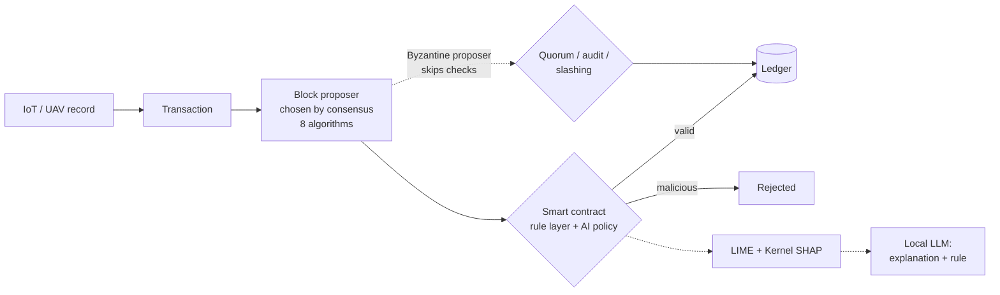
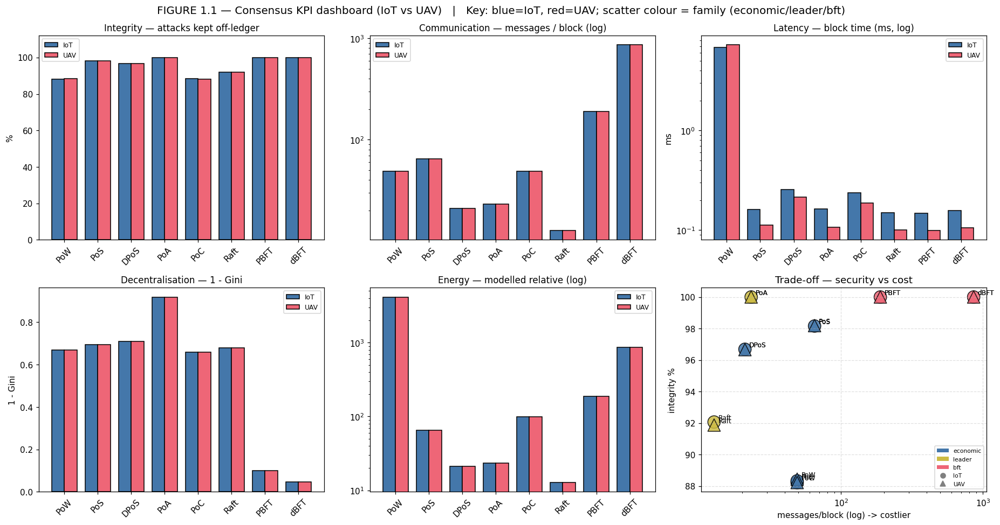
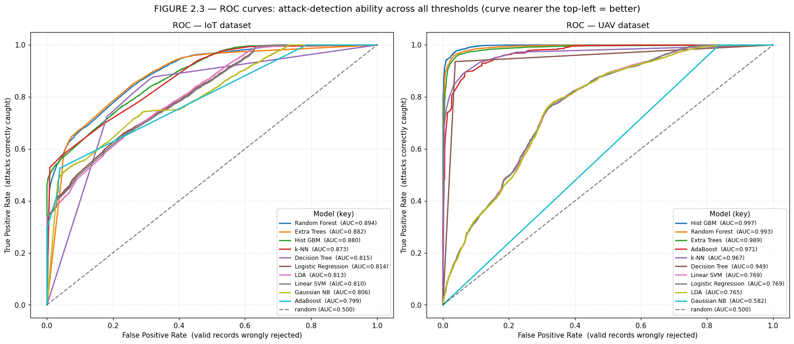
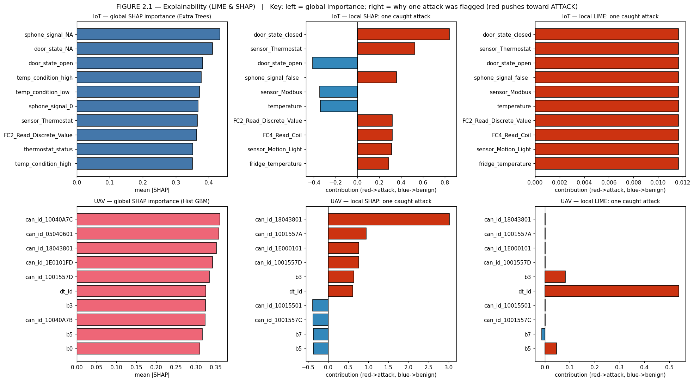
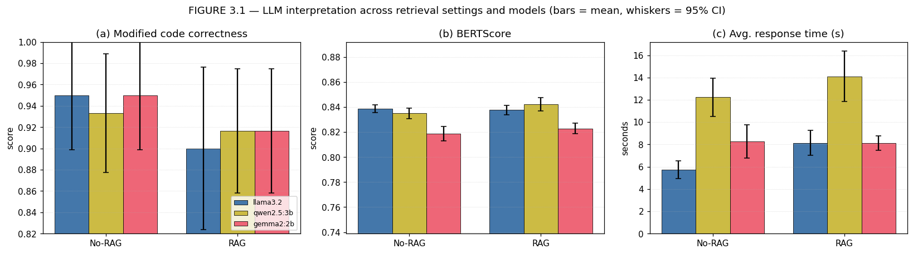
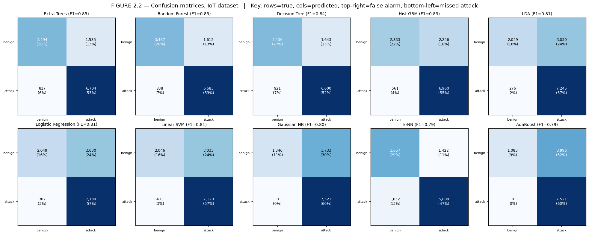
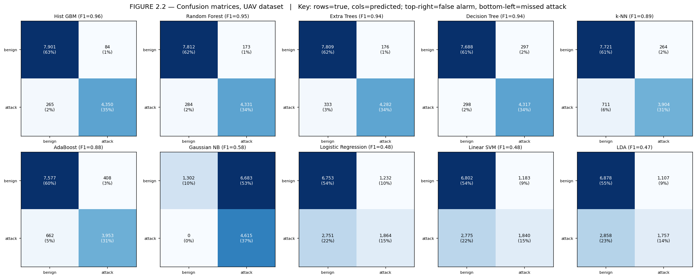
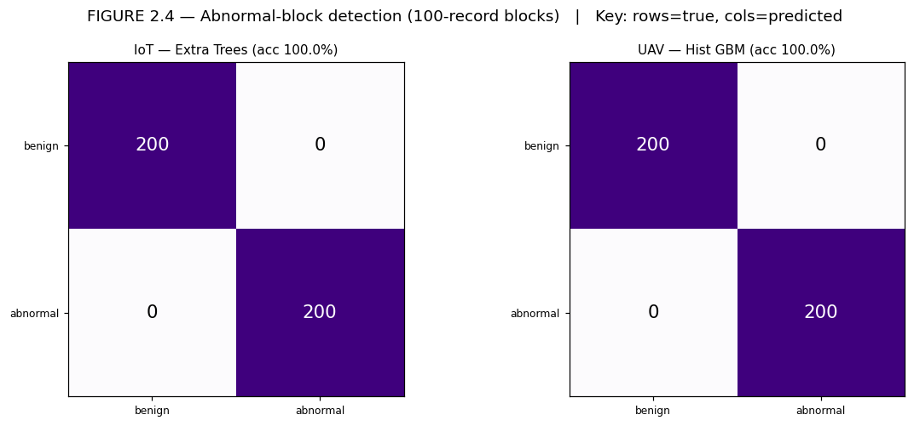

# Explainable Blockchain–AI Misbehaviour Detection for IoT and UAV Networks

**Blockchain consensus · ML intrusion detection · LIME/SHAP explainability · local LLM interpretation**

MSc Cybersecurity dissertation, University of Surrey, 2026. Supervised by Dr Mohammad Shojafar.
The consensus, detection and explainability work (Parts 1–2) is also published as a lead-author paper at **IEEE NextGCom 2026** (in press). The LLM stage (Part 3) is new in the dissertation.


-black)

[](https://colab.research.google.com/github/Yousefscode/Xai-blockchain-misbehaviour-detection/blob/main/notebooks/xai_blockchain_misbehaviour_detection.ipynb)

---

IoT and UAV devices talk over shared, often unauthenticated channels. One misbehaving node can inject false telemetry or CAN frames and corrupt every decision built on that data.

This project builds and measures a single pipeline that brings together three defences usually studied separately:

1. A **blockchain ledger** that makes records tamper-evident.
2. **Machine-learning detectors** that decide whether a record is malicious.
3. **Explainability plus an LLM** that tell an analyst *why* a record was flagged and propose a rule to block it.

Every record from two open, labelled datasets (TON_IoT and UAVCAN) is turned into a ledger transaction and pushed through the full pipeline. The consensus algorithms, detectors, explainers and LLM evaluation are all implemented from first principles in Python, and every run is seeded so it can be reproduced.



## Key results

| Question | Result |
|---|---|
| **Which consensus algorithms keep attacks off the ledger?** | PBFT, dBFT and PoA blocked **100%** of attacks. PoS 98.2%, DPoS 96.7%. **Raft let in about 8%**: crash tolerance is not the same as attack resistance. |
| **What does that security cost?** | Raft needs 13 messages per block, dBFT 860. PoW has by far the highest modelled energy cost. |
| **Can deterministic contract rules catch the attacks alone?** | **No.** About 0% (IoT) and 1.2% (UAV) were caught, because attacks use registered IDs, valid lengths and plausible timing. The learned detector is necessary. |
| **Best detector** | UAV: Histogram Gradient Boosting, **F1 0.961, AUC 0.997**. IoT: Extra Trees, **F1 0.848, AUC 0.882**. |
| **Block-level detection** | **100%** accuracy on both datasets (200/200 abnormal blocks caught, 0 false alarms). |
| **What does explainability reveal?** | UAV attacks are **protocol-conformant payload injections, not floods**. SHAP ranks CAN ID and payload bytes highest and inter-frame timing 26th of 30. That is why the rule layer misses them. |
| **Can small local LLMs explain alerts and write rules?** | Yes. Llama 3.2, Qwen 2.5 3B and Gemma 2 2B reached **0.90–0.95 code correctness** and **BERTScore 0.82–0.84**. |
| **Does RAG help?** | Not measurably for these small models. It added up to 2.4 s of latency with no quality gain, which bounds a previously published finding to larger models. |

### Consensus benchmark



### Detection

<p align="center">
  
</p>

| Model (UAV dataset) | Accuracy | Precision | Recall | F1 | ROC-AUC | MCC |
|---|---:|---:|---:|---:|---:|---:|
| **Hist GBM** | **0.972** | **0.981** | **0.943** | **0.961** | **0.997** | **0.940** |
| Random Forest | 0.964 | 0.962 | 0.938 | 0.950 | 0.993 | 0.922 |
| Extra Trees | 0.960 | 0.961 | 0.928 | 0.944 | 0.989 | 0.913 |
| Decision Tree | 0.953 | 0.936 | 0.935 | 0.936 | 0.949 | 0.898 |
| k-NN | 0.923 | 0.937 | 0.846 | 0.889 | 0.967 | 0.832 |
| Logistic Regression | 0.684 | 0.602 | 0.404 | 0.483 | 0.769 | 0.279 |

Linear models fail on the UAV data because the attack signature lies in *combinations* of payload bytes, which a single hyperplane cannot separate. The full tables for both datasets and all ten models are in the notebook and the dissertation.

### Explainability (LIME and Kernel SHAP, implemented from scratch)



### LLM-assisted interpretation



<details>
<summary>More figures: confusion matrices and block-level detection</summary>





</details>

## What's implemented

- **8 consensus algorithms:** PoW (real SHA-256 mining), PoS, DPoS, PoA, PoC, Raft, PBFT, dBFT. Each is measured for integrity, messages per block, latency, decentralisation (1 − Gini) and modelled energy.
- **2 two-layer smart contracts** (IoT and UAV). Each has a deterministic rule layer (device registry, data length, rate limit) and a pluggable anomaly policy.
- **10 detectors:** Logistic Regression, LDA, Gaussian NB, k-NN, Linear SVM, Decision Tree, Random Forest, Extra Trees, AdaBoost and Hist GBM. They are evaluated with ML metrics *and* blockchain metrics: FNR (attacks admitted to the ledger) and FPR (valid records rejected).
- **LIME and Kernel SHAP** written from first principles, cross-checked against each other.
- **LLM stage:** three local models served by Ollama, each run with and without TF-IDF RAG over a 16-document security knowledge base. Each generates a plain-English justification and a Python smart-contract rule, scored with a 5-criterion code-correctness rubric, BERTScore and response time.

## Repository layout

```
├── notebooks/
│   └── xai_blockchain_misbehaviour_detection.ipynb   # the full pipeline (Parts 1–3)
├── data/
│   ├── README.md          # dataset sources, licences and layout
│   ├── iot/               # TON_IoT telemetry CSVs (included)
│   └── uav/               # UAVCAN .bin files (download separately, see data/README.md)
├── figures/               # result figures used in this README
├── docs/MSc_Dissertation_Abdelghani.pdf  # full dissertation
└── requirements.txt
```

## Running it

**Google Colab (easiest).** Open the notebook with the badge above. Upload the IoT CSVs and the UAVCAN `.bin` files to `/content`, or mount them in the same folder. For Part 3, switch to a GPU runtime (*Runtime → Change runtime type → T4 GPU*); the first run downloads a few GB of models.

**Locally:**

```bash
git clone https://github.com/Yousefscode/Xai-blockchain-misbehaviour-detection.git
cd Xai-blockchain-misbehaviour-detection
pip install -r requirements.txt
# put the UAVCAN files in data/uav/ (see data/README.md)
jupyter notebook notebooks/xai_blockchain_misbehaviour_detection.ipynb
```

Parts 1–2 run on a CPU. Part 3 needs [Ollama](https://ollama.com) with `llama3.2`, `qwen2.5:3b` and `gemma2:2b` pulled. If Ollama isn't running, the notebook falls back to a clearly labelled simulation mode, which is not used for any reported numbers.

## Limitations

- Block times are simulation compute times, not network latencies. Energy is a modelled relative quantity. The adversary fraction is assumed. Relative ordering between protocols holds because all are measured under identical conditions.
- IoT false-positive rates at record level are high (31–44% for the best models). Block-level aggregation absorbs this, but record-level availability still pays a cost.
- The LLM evaluation uses six sampled attacks per dataset, so confidence intervals are wide. BERTScore is measured against an automatically generated reference.
- Results come from two datasets. Generalising to other deployments is an assumption, not something shown here.

## Citation

```bibtex
@inproceedings{abdelghani2026explainable,
  author    = {Abdelghani, Yousef and Shojafar, Mohammad},
  title     = {Explainable Blockchain--AI Misbehaviour Detection for IoT and UAV Networks},
  booktitle = {Proceedings of the IEEE International Conference on Next Generation Communications (NextGCom)},
  year      = {2026},
  note      = {In press}
}
```

## Author

**Yousef Abdelghani** · [LinkedIn](https://www.linkedin.com/in/yousef-abdelghani-6a3ba9213) · [GitHub](https://github.com/Yousefscode)

Code is released under the [MIT License](LICENSE). The datasets keep their own licences (see [`data/README.md`](data/README.md)). The dissertation PDF remains © Yousef Abdelghani.
